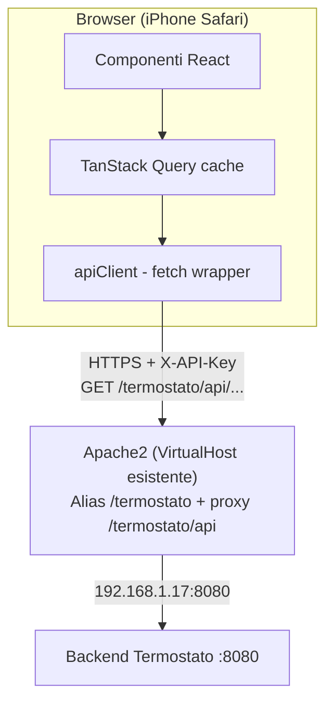

# Specifiche tecniche — Frontend Termostato intelligente

> Documento di progettazione tecnica per l'implementazione della web-app di
> gestione del termostato. Il backend esiste già ed espone i servizi REST
> descritti in [`openapi.yaml`](./openapi.yaml). I requisiti funzionali del
> sistema sono in [`specifiche-funzionali.md`](./specifiche-funzionali.md).

## 1. Obiettivo e ambito

Realizzare una **web-app mobile-first** che permetta di:

1. Visualizzare lo stato corrente del termostato (`GET /stato`): temperatura
   ambiente, temperatura target attiva e stato reale del relay.
2. Visualizzare e modificare la configurazione di sistema (`GET`/`PUT /config`).
3. Visualizzare e modificare il calendario settimanale (`GET`/`PUT /config/calendario`).
4. Consultare i log di polling (`GET /log`) con filtro per range di date.
5. Consultare i log di errore (`GET /log/errori`) con filtro per range di date.
6. (Opzionale) Mostrare lo stato di salute del backend (`GET /actuator/health`).
7. Gestire i **dispositivi Shelly** della rete locale (area dedicata
   "Dispositivi"): visualizzare l'elenco dei dispositivi configurati
   (`GET /shelly/dispositivi`), leggerne lo stato in tempo reale
   (`GET /shelly/stato/{id}`) e comandare i relè
   (`POST /shelly/relay/{id}/on|off`).
8. Monitorare in **tempo reale** il consumo istantaneo dei dispositivi con power
   meter dell'area Dispositivi (`GET /shelly/stato/{id}`): totale e grafico a
   barre che cresce e cambia colore in base alla potenza (verde sotto i 100 W →
   arancione → rosso) con un intervallo di aggiornamento configurabile in
   secondi.

L'ambito è **esclusivamente il frontend**. Il backend non viene modificato. Il
consumo del contratto REST inbound è quello descritto in `openapi.yaml`; gli
endpoint `mock/*`, `/temperature`, `/relay` non sono usati dal frontend (sono
per lo scenario E2E lato backend). Gli **endpoint `/shelly/*` sono invece reali
in ogni profilo backend** (incluso `mock`): solo il sensore e il relay del
termostato vengono simulati dal profilo mock, i dispositivi Shelly vengono
sempre interrogati ai loro IP di rete.

## 2. Vincoli di contesto

| Vincolo | Origine | Impatto sulla progettazione |
|---|---|---|
| Uso da smartphone, in particolare iPhone | Richiesta utente | Layout mobile-first, test su Safari/WebKit, touch target ≥ 44px, viewport `safe-area-inset` |
| Deploy su Linux con Apache2 + HTTPS funzionante | Richiesta utente | Il frontend è un **bundle statico** servito da Apache; nessun runtime Node in produzione |
| Preferenza per la semplicità | Richiesta utente | Stack minimale, poche dipendenze, nessun backend-for-frontend dedicato |
| Autenticazione via `X-API-Key` | `openapi.yaml`, sez. 3.8 / 7.0 | Vedi capitolo 5 (Sicurezza): il segreto non può risiedere nel bundle |
| Stato corrente | `openapi.yaml`, `GET /stato` | Dashboard read-only; ogni richiesta legge temperatura/umidità interne, relay e dati esterni nullable; nessun comando di attuazione dal frontend |
| JSON in `snake_case` | `openapi.yaml` (info) | Tipi TypeScript con proprietà in snake_case; nessuna conversione automatica |
| Date/orari nel fuso configurato | Specifiche funzionali, `openapi.yaml` | Il frontend visualizza e invia i valori locali senza conversione UTC (vedi cap. 7) |

## 3. Scelte tecnologiche (con motivazione)

Criterio guida: **semplicità**, poche dipendenze, output statico servibile da Apache.

### 3.1 Stack raccomandato

| Layer | Tecnologia | Motivazione |
|---|---|---|
| Linguaggio | **TypeScript** | Il contratto OpenAPI è ricco e tipizzato; TS previene errori sui nomi snake_case e sui campi nullable |
| Framework UI | **React 18** | Ecosistema ampio, curva nota, ottimo supporto mobile |
| Build tool | **Vite** | Zero-config, build statica velocissima, output = cartella `dist/` di file statici → ideale per Apache |
| Routing | **React Router** | Poche route (config, calendario, log, errori); soluzione standard |
| Data fetching | **TanStack Query (React Query)** | Cache, refetch, gestione loading/error con pochissimo codice; evita di scrivere state management a mano |
| Form | **React Hook Form** + **Zod** | Validazione dichiarativa allineata ai vincoli OpenAPI (min/max, multipleOf 0.1, campi obbligatori) |
| Styling | **Tailwind CSS** | Scelta confermata. Per chi viene dal back-end è il percorso più semplice: utility direttamente nel markup, nessun file CSS da mantenere, mobile-first immediato con i prefissi responsive |
| Grafici | **Recharts** | Visualizzazione grafica dei log (andamento temperatura/target). API dichiarativa React, semplice per grafici a linee; buona resa su mobile |
| Liste lunghe | **react-window** | Virtualizzazione della tabella log di polling (~1440 righe/giorno): renderizza solo le righe visibili, mantiene la UI fluida |
| PWA | **vite-plugin-pwa** | Genera manifest e service worker (Workbox) con configurazione minima; abilita "Aggiungi a Home" su iPhone |
| Client HTTP | **fetch** nativo (wrapper sottile) | Nessuna libreria HTTP aggiuntiva necessaria |
| Tipi API | Generati da OpenAPI con **openapi-typescript** | Tipi sempre allineati al contratto; una sola fonte di verità |

> Nota sulla semplicità: se anche React viene considerato troppo, un'alternativa
> più leggera è **Preact + Vite** (API compatibile React, bundle ~3x più
> piccolo). React resta la raccomandazione per la maturità dell'ecosistema.
>
> Nota sullo styling (profilo back-end): **Tailwind CSS** è consigliato proprio
> per chi conosce poco i framework front-end. Non richiede di scrivere e
> mantenere CSS separato né di ragionare su naming/cascade: si compongono classi
> utility direttamente nel markup e il responsive mobile-first si ottiene con
> prefissi come `sm:`/`md:`. Riduce al minimo le decisioni di design.

### 3.2 Alternative valutate e scartate

- **Next.js / SSR**: introduce un runtime server (Node) in produzione. Non
  necessario e in contrasto con "bundle statico su Apache". Scartato.
- **Angular**: valido ma più verboso e con più boilerplate del necessario per
  ~4 schermate. Scartato per semplicità.
- **Vanilla JS senza framework**: massimizza la semplicità delle dipendenze ma
  richiede di scrivere a mano data-binding, validazione e fetch state; per la
  quantità di form (config + calendario) il costo cresce. Scartato.

### 3.3 Tooling di sviluppo

- **Node.js** (LTS) solo in fase di sviluppo/build (mai in produzione).
- **ESLint** + **Prettier** per qualità e formattazione.
- **Vitest** + **Testing Library** per unit/component test.
- **Playwright** (opzionale) per E2E su almeno un flusso critico (modifica config).

## 4. Architettura del frontend



### 4.1 Struttura delle cartelle proposta

```
src/
  main.tsx                 # bootstrap React
  App.tsx                  # router + layout
  api/
    generated.ts           # tipi generati da openapi.yaml (openapi-typescript)
    client.ts              # wrapper fetch: base URL, header X-API-Key, gestione errori/401
    types.ts               # alias dei tipi generati usati dalle pagine
    endpoints.ts           # funzioni endpoint: stato, config, calendario, log, health, shelly
  auth/
    apiKeyStore.ts         # lettura/scrittura/rimozione chiave in localStorage
    ApiKeyGate.tsx         # gate: mostra inserimento chiave se assente/non valida
    useApiKey.ts           # hook per accedere/aggiornare la chiave
  hooks/
    useApi.ts              # React Query: queryKeys + hook per tutti gli endpoint
  pages/
    StatusPage.tsx         # dashboard stato corrente, route /stato
    ConfigPage.tsx
    CalendarPage.tsx
    LogsPage.tsx
    ErrorLogsPage.tsx
    SettingsPage.tsx       # API-key + link alla configurazione sistema
    ShellyPage.tsx         # area Dispositivi: elenco + comando relè, route /shelly
    ShellyMonitorPage.tsx  # monitor consumo istantaneo, route /shelly/monitor
  components/
    forms/                 # campi form riutilizzabili (temperatura, orario, ecc.)
    layout/AppLayout.tsx   # header con selettore d'area + bottom nav per area
    common/                # LoadingState/ErrorState/EmptyState/InlineNotice
  lib/
    datetime.ts            # parsing e formattazione dei timestamp locali
    shelly.ts              # capacità dei tipi Shelly (relè, power meter) e formattazione misure
    shellyMonitor.ts       # scala e colori del monitor di consumo istantaneo
    validation.ts          # schemi Zod allineati a OpenAPI
  styles/
```

### 4.2 Layer di accesso ai dati

- `api/client.ts` centralizza: base URL, header `X-API-Key` (vedi cap. 5),
  serializzazione JSON, parsing risposte, mappatura degli errori (`ApiError`,
  `UnauthorizedError`) in un formato uniforme per la UI.
- `api/endpoints.ts` espone una funzione per ogni endpoint usato (es.
  `getCurrentState()` per `GET /stato`, `getShellyStato(id)` per
  `GET /shelly/stato/{id}`, `setShellyRelay(id, on)` per
  `POST /shelly/relay/{id}/on|off`), ciascuna con il tipo generato dalla
  risposta.
- I tipi TypeScript sono **generati** da `openapi.yaml` così da restare allineati
  al contratto (`npm run generate:api` → `src/api/generated.ts`); `api/types.ts`
  re-esporta i tipi rilevanti per le pagine.
- `hooks/useApi.ts` concentra i **hook React Query** (cache, stato di
  caricamento, invalidazione dopo le `PUT`) e i `queryKeys`. Lo stato corrente
  gestisce refresh manuale e polling non aggressivo (60 s); lo stato dei
  dispositivi Shelly (`useShellyStato`) si riaggiorna ogni 30 s nella pagina
  Dispositivi e con l'intervallo scelto dall'utente nella pagina Monitor. Il
  comando relè aggiorna la cache di `shellyStato` con `acceso` restituito dalla
  risposta.

## 5. Sicurezza e gestione della API-key

Il backend richiede l'header `X-API-Key` su **tutti** gli endpoint e la lista
`api_keys` è fail-closed. Una SPA statica **non può custodire un segreto**: tutto
ciò che finisce nel bundle o nel browser è ispezionabile dall'utente.

**Soluzione adottata: la chiave viene inserita dall'utente e salvata nel
browser.** Il frontend non contiene alcuna chiave nel bundle; è l'utente a
fornirla la prima volta, e il client la aggiunge all'header `X-API-Key` di ogni
richiesta.

Questa scelta è adeguata a un contesto **personale/domestico**, in cui l'app è
usata da un numero ristretto di dispositivi fidati (l'iPhone del proprietario) e
il livello di rischio accettato è coerente con la semplicità richiesta.

### 5.1 Comportamento funzionale

1. **Primo accesso / chiave assente**: se in `localStorage` non è presente una
   chiave valida, l'app mostra una schermata (o modale) di **inserimento
   API-key** prima di consentire l'accesso alle altre funzionalità.
2. **Persistenza**: la chiave viene salvata in `localStorage` (chiave
   dedicata, es. `termostato.apiKey`). Sopravvive alla chiusura del browser e al
   riavvio del dispositivo, così l'utente non deve reinserirla ogni volta —
   utile per l'uso da iPhone con "Aggiungi a Home".
3. **Uso**: `api/client.ts` legge la chiave dallo storage e la aggiunge
   all'header `X-API-Key` di ogni chiamata.
4. **Gestione `401`**: se una richiesta risponde `401 Unauthorized` (chiave
   mancante, vuota o non più valida), il client:
   - considera la chiave salvata come non valida,
   - la rimuove (o la marca come invalida) dallo storage,
   - reindirizza l'utente alla schermata di inserimento chiave con un messaggio
     esplicito ("API-key non valida o non autorizzata").
5. **Reset manuale**: nella schermata "Impostazioni" l'utente può cancellare o
   sostituire la chiave salvata (utile in caso di rotazione delle `api_keys`).

### 5.2 Compromessi accettati (da dichiarare esplicitamente)

- La chiave è **leggibile in chiaro** nel browser (dev tools, `localStorage`):
  non è un segreto server-side. Accettabile solo per uso personale su dispositivi
  fidati.
- Chiunque abbia accesso fisico/sbloccato al dispositivo può leggere la chiave.
- `localStorage` non è isolato da eventuale codice JavaScript malevolo iniettato
  nella pagina: per questo è essenziale una **Content-Security-Policy** rigorosa
  (vedi 5.4) e servire solo asset propri.

### 5.3 Connessione al backend (CORS)

Poiché il frontend parla direttamente con il backend inviando l'header, occorre
garantire lo **stesso origin** per evitare problemi CORS. Si mantiene Apache come
**reverse proxy** verso il backend (senza iniettare alcuna chiave), così browser
e API condividono l'origin HTTPS del sito.

Dato che l'app è pubblicata in **sotto-cartella** (`https://sliverd.ddns.net/termostato`,
vedi cap. 10), anche il proxy API vive sotto lo stesso prefisso: il frontend usa
come base URL **`/termostato/api`** e Apache proxa quel path verso il backend.
Questo evita ogni collisione con il sito già presente sulla home del dominio.
L'header `X-API-Key` fornito dall'utente viene inoltrato invariato al backend.
La configurazione Apache completa è nel cap. 10.2.

### 5.4 Altre misure

- Servire tutto **solo su HTTPS** (già disponibile) — la chiave viaggia
  cifrata sul canale.
- Header di sicurezza consigliati via Apache: `Content-Security-Policy` rigorosa
  (limita gli origin degli script), `X-Content-Type-Options: nosniff`,
  `Referrer-Policy: no-referrer`.
- Nessun log della chiave lato client (né console, né telemetria).
- Il campo di inserimento chiave usa `type="password"` e `autocomplete="off"`
  per evitare esposizione a schermo e archiviazioni indesiderate.

## 6. Funzionalità e schermate

All'avvio l'app applica un **gate sulla API-key** (`ApiKeyGate`): se non è
presente una chiave in `localStorage`, mostra la schermata di inserimento chiave
(vedi 6.7) prima di ogni altra funzionalità.

L'app è organizzata in **due aree**, selezionabili con un **selettore d'area
nell'header** (tabs "🏠 Termostato" e "💡 Dispositivi"). Il tab "💡 Dispositivi"
apre di default la sottosezione **Monitor** (`/shelly/monitor`); la pagina
Dispositivi resta raggiungibile dalla relativa voce della bottom navigation.
L'area attiva è derivata
dal pathname (`/shelly`… → area Dispositivi). La **bottom navigation cambia in
base all'area**:

- **Area Termostato** — 5 voci: **Stato** (`/stato`), Calendario (`/calendario`),
  Log (`/log`), Errori (`/errori`), Impostaz. (`/settings`). La configurazione
  completa resta disponibile nella route `/config`, raggiungibile dal pulsante
  "Configurazione sistema" della schermata Impostazioni (così la barra non viene
  sovraccaricata con una sesta voce). La schermata Stato è la destinazione
  iniziale dopo il gate.
- **Area Dispositivi** — 2 voci: **Monitor** (`/shelly/monitor`, consumo
  istantaneo) e **Dispositivi** (`/shelly`, pagina con elenco e comando dei
  relè). Non esistono pagine di storico dei
  consumi: il backend non registra le misure.

### 6.1 Schermata Stato corrente (`/stato`)

- È la **dashboard iniziale** e la voce principale della bottom navigation.
- Carica lo stato con `GET /stato` tramite `useCurrentState`.
- Il backend esegue a ogni richiesta la lettura di temperatura e umidità interne,
  la risoluzione del target, la lettura del relay e l'acquisizione best-effort
  dei dati esterni. Il frontend tratta la risposta come una lettura **read-only**,
  senza tentare di comandare direttamente la caldaia.
- Visualizza in modo immediato:
  - `temperatura`: temperatura interna, con una cifra decimale e unità `°C`;
  - `umidita`: umidità relativa interna, con una cifra decimale e unità `%`;
  - `temperatura_target`: target attivo, con una cifra decimale; se è `null`
    mostrare **"Nessun target attivo"**;
  - `relay_acceso`: stato reale del relay, con indicatore evidente **ON/OFF**;
  - `temperatura_esterna`: temperatura esterna in °C, oppure `—` se `null`;
  - `umidita_esterna`: umidità esterna in %, oppure `—` se `null`.
- Se `temperatura_target` è `null`, il frontend non deve dedurre lo stato del
  relay dal target: mostra sempre il valore effettivamente restituito da
  `relay_acceso`.
- Aggiornamento dati:
  - caricamento all'ingresso nella pagina e pulsante **"Aggiorna"** manuale;
  - refetch automatico ogni **60 secondi**, sospeso quando la pagina non è
    visibile, perché ogni chiamata legge sensore, relay e servizio meteo;
  - indicare l'istante dell'ultima richiesta usando l'ora locale del dispositivo.
    L'istante è una marca locale del frontend: il contratto `/stato` non
    restituisce un timestamp del backend.
- Stati UI obbligatori: skeleton/loading iniziale, errore `500` con messaggio
  comprensibile e azione "Riprova", gestione `401` tramite il gate API-key,
  valori esterni `null` visualizzati come non disponibili e dati aggiornati
  durante il refetch.
- La schermata non espone comandi di accensione/spegnimento: il backend espone
  per questo caso solo una lettura dello stato corrente.

### 6.2 Schermata Configurazione (`/config`)

- Carica con `GET /config`, salva con `PUT /config`.
- Form con validazione allineata a `SystemConfiguration`:
  - `soglia_attivazione`: number ≥ 0, step 0.1.
  - `override_attivo`: toggle. Se true → `temperatura_override` **obbligatorio**
    (Zod: refinement), altrimenti campo disabilitato/null.
  - `override_fine`: date-time picker opzionale (`datetime-local`), rilevante solo con
    `override_attivo = true`. Orario civile locale, stesso fuso/ora legale del calendario.
    Serializzato in ISO **senza** offset né suffisso `Z` (`YYYY-MM-DDTHH:mm:ss`); vuoto → `null`
    (forzatura a tempo indeterminato). Validazione client: se valorizzato deve essere **futuro**
    (Zod refinement `isFutureLocalTimestamp`); il `400` del backend viene comunque mostrato con il
    messaggio dell'`ApiError`. La config viene ricaricata con polling periodico (60 s) così che,
    all'auto-disattivazione lato backend, la UI rifletta `override_attivo = false`.
    Comodità client: pulsante "Fino al prossimo cambio fascia" che calcola lato front-end
    (`nextIntervalStart` su `GET /config/calendario`) l'inizio della prossima fascia e lo
    imposta come `override_fine` concreto (orario locale, senza offset). Non è una funzionalità
    del backend.
  - `intervallo_polling_secondi`: intero ≥ 1.
  - `max_errori_consecutivi`: intero ≥ 1.
  - `retention_log_giorni`: intero ≥ 1.
  - `ntfy_url`, `sensore_url`, `relay_url`: URI non vuoti.
  - `ntfy_topic`: stringa non vuota.
  - `debug_mode`: toggle per notifiche informative di accensione/spegnimento.
  - `notifiche_errori_abilitate`: toggle per abilitare/disabilitare le notifiche
    di errore inviate tramite ntfy.
  - `fuso_orario`: stringa IANA obbligatoria (es. `Europe/Rome`) usata dal
    backend per interpretare date e orari.
  - `ora_legale`: toggle che abilita le regole DST del fuso configurato.
  - `meteo_esterno_url`: URI del servizio meteo.
  - `meteo_esterno_latitudine` e `meteo_esterno_longitudine`: coordinate del
    punto usato per le letture esterne.
  - `api_keys`: editor di lista di stringhe (aggiungi/rimuovi), `uniqueItems`.
  - `database_path`: **read-only** in UI (bootstrap-only; va rispedito invariato
    nel `PUT`). Mostrare nota "modificabile solo al riavvio".
  - `alert_soglia`: number ≥ 0 in watt (decimale ammesso, es. `1500.75`).
  - `alert_polling`: intero ≥ 0 in secondi, con `step="1"` sull'input.
- I due campi dell'alert di consumo (`alert_soglia`, `alert_polling`) stanno in una
  sezione dedicata "Alert di consumo" e vanno **sempre** reinviati nella `PUT`: il
  backend è una sostituzione completa e azzera i campi mancanti **senza restituire
  errore**, quindi ometterli disattiverebbe l'alert silenziosamente. Se un backend
  vecchio non espone i due campi, il form ripiega esplicitamente su `0`/`0` invece
  di mandare `undefined`.
- La sezione rende visibile la **regola di attivazione congiunta** (`alert_soglia > 0`
  **AND** `alert_polling > 0`): testo esplicativo ("servono entrambi i valori
  maggiori di zero") più una riga di stato derivata dai due valori
  (`Alert attivo` / `Alert disabilitato`). Lo stato si deduce dai campi: il backend
  non espone alcun indicatore di superamento, ultima somma o storico alert.
- Validazione client: `min="0"` su entrambi gli input e `step="1"` su `alert_polling`
  (il backend **tronca** `2.5` a `2` senza errore). Lo schema Zod rifiuta comunque
  negativi e non interi come seconda rete; il `400` del backend resta gestito come
  rete di sicurezza.
- `debug_mode` e `notifiche_errori_abilitate` **non** controllano l'alert di consumo:
  non vanno proposti come opzioni nella sua sezione. Le notifiche di superamento
  viaggiano sul topic ntfy già configurato e la frequenza di controllo
  (`alert_polling`) è indipendente da `intervallo_polling_secondi`.
- La `PUT /config` richiede l'oggetto completo → il form deve reinviare **tutti**
  i campi letti, non solo quelli modificati (merge sullo stato caricato).
- I campi del logging dei consumi Shelly (`intervallo_polling_consumi_secondi`,
  `logging_pm_abilitato`, `retention_consumi_giorni`) **non esistono più** nel
  contratto: non vanno mostrati nel form e non vanno inviati nella `PUT`, che li
  rifiuterebbe.
- Gestione `400` → mostrare `message` dell'`ApiError`.

### 6.3 Schermata Calendario (`/config/calendario`)

- Carica con `GET /config/calendario`, salva con `PUT /config/calendario`.
- Struttura: 7 giorni canonici (`lunedi`…`domenica`), ciascuno con lista di
  intervalli (`ora_inizio`, `ora_fine`, `temperatura_target`).

**Volume atteso.** Ogni giorno ha **almeno 4 intervalli** (e potenzialmente di
più). Mostrare tutti i 7 giorni con tutti gli slot inline satura lo schermo del
telefono: la schermata usa un layout **ad accordion**.

- **Layout ad accordion (un giorno alla volta)**: i 7 giorni sono righe
  espandibili. La riga collassata mostra nome del giorno e un riepilogo (numero
  di intervalli, es. "4 intervalli"). Toccando il giorno si espande la lista
  completa dei suoi intervalli con l'editor.
- Il giorno **corrente** è espanso di default; gli altri sono collassati.
- **Editor per giorno** (giorno espanso): elenco degli intervalli, ciascuno con
  campi `ora_inizio`/`ora_fine` (`HH:mm`) e `temperatura_target` (step 0.1),
  azione **rimuovi** per intervallo e **"+ Aggiungi intervallo"** in fondo al
  giorno. Gli intervalli sono ordinati per ora di inizio.
- Validazioni lato client (per evitare `400` evitabili):
  - `ora_inizio` < `ora_fine`.
  - Intervalli dello stesso giorno **non sovrapposti** (evidenziare in rosso
    l'intervallo in conflitto).
  - Orari nel formato `HH:mm` (rientra nel pattern accettato dal backend).
  - `temperatura_target` con una cifra decimale.
- **Fuso orario**: l'utente edita e vede gli orari nel fuso civile indicato dal
  backend tramite `fuso_orario` (IANA, default `Europe/Rome`). Il parametro
  `ora_legale` indica se il backend applica le regole DST del fuso. Il frontend
  non converte gli orari: legge e invia `ora_inizio`/`ora_fine` nello stesso
  formato locale (`HH:mm`) restituito dal contratto.
- **Salvataggio**: un unico pulsante "Salva" persiste l'intero calendario. Il
  `PUT` deve contenere **esattamente i 7 giorni**; i giorni senza intervalli
  vanno inviati come array vuoti.
- Suggerimento UX: azione rapida **"Copia su altri giorni"** per replicare gli
  intervalli di un giorno su altri (comodo con 4+ slot ripetuti nella settimana).

### 6.4 Schermata Log di polling (`/log`)

- `GET /log?da=&a=` con parametri opzionali (`format: date`) nel fuso configurato.
- Default senza parametri → giorno corrente del fuso configurato (gestito dal backend).
- Filtro con due date-picker (`da`, `a`); validazione client `da <= a`.

**Volume dati.** Il backend scrive un record **ad ogni ciclo di polling** (con
polling a 60 s → ~1440 record al giorno). Un elenco a card per singolo record è
inadatto: la vista primaria è il **grafico**; il dettaglio riga è opzionale e in
forma di **tabella compatta**.

- **Visualizzazione grafica (vista primaria, richiesta)**: un **grafico a linee**
  (Recharts) mostra l'andamento nel tempo di:
  - `temperatura_rilevata` (temperatura interna, linea continua);
  - `temperatura_target` (linea tratteggiata; assente/gap quando `null`);
  - `temperatura_esterna` (linea distinta; gap quando `null`);
  - `umidita_rilevata` (umidità interna);
  - `umidita_esterna` (umidità esterna; gap quando `null`);
  - lo stato caldaia (`caldaia_accesa`) come marcatori/banda ON/OFF.
  Le temperature usano una scala °C e le umidità una scala percentuale 0–100,
  con legenda distinta. Il grafico usa lo stesso range di date del filtro (`da`/`a`)
  e l'asse tempo è in **ora locale** (vedi cap. 7). Su dataset ampi i punti
  vengono campionati/aggregati per mantenere la resa fluida su mobile.
- **Dettaglio (tabella compatta, nascosta di default)**: la vista mostra di
  **default solo il grafico**. Il dettaglio riga-per-riga è disponibile tramite
  un pulsante **"Mostra dettaglio"** che espande una **tabella densa** con scroll
  orizzontale su smartphone. Colonne: ora locale (`HH:mm`), stato caldaia,
  temperatura interna, umidità interna, temperatura esterna, umidità esterna e
  target. I valori esterni `null` vengono visualizzati come `—`.
- Accorgimenti per il volume (quando la tabella è espansa):
  - Ordinamento di default per timestamp **decrescente** (voci più recenti in
    cima), configurabile.
  - **Virtualizzazione** della lista (react-window) per non renderizzare 1440
    righe in DOM contemporaneamente.
  - Campi `override_attivo` e `temperatura_override`, poco utili riga-per-riga ad
    alta frequenza, sono consultabili aprendo la singola riga (dettaglio) e non
    occupano colonne fisse.

### 6.5 Schermata Log di errore (`/log/errori`)

- `GET /log/errori?da=&a=`, stessa semantica di `/log`.
- Ogni record: data/ora, `tipo_errore`, caldaia (nullable), temperatura rilevata
  (nullable), `num_errori_consecutivi`.
- Evidenziare visivamente la severità (colore) e il conteggio consecutivo.

### 6.6 Stato backend (opzionale)

- `GET /actuator/health` per un indicatore UP/DOWN nell'header.

### 6.7 Schermata Impostazioni / API-key (`/settings`)

- È la quinta voce della bottom navigation e contiene la gestione della chiave
  API oltre ai collegamenti alle impostazioni applicative.
- Mostra lo stato corrente della chiave (impostata / non impostata), senza mai
  rivelarla in chiaro (es. solo ultimi caratteri mascherati).
- **Inserimento/sostituzione chiave**: campo `type="password"`,
  `autocomplete="off"`; al salvataggio la chiave va in `localStorage`.
- **Rimozione chiave**: pulsante che cancella la chiave dallo storage e riporta
  al gate di inserimento.
- Espone un'azione/link **"Configurazione sistema"** verso `/config`, che apre
  il form completo di `GET`/`PUT /config` descritto nella sezione 6.2.
- Questa schermata è anche la destinazione del **redirect automatico su `401`**
  (chiave mancante/non valida), con messaggio esplicativo.
- All'inserimento è consigliata una **verifica** immediata della chiave con una
  chiamata leggera (es. `GET /actuator/health` o `GET /stato`): se risponde
  `401`, la chiave è rifiutata e non viene salvata come valida.

### 6.8 Area Dispositivi: profilo dati e struttura

- Gli endpoint **`/shelly/*` sono sempre reali**, anche con profilo backend
  `mock`: il mock simula solo sensore di temperatura/umidità e relay del
  termostato; i dispositivi Shelly vengono letti dalla configurazione
  `shelly.json` e interrogati ai loro IP di rete. Il frontend non conosce il
  profilo attivo e non cambia comportamento.
- L'elenco dei dispositivi arriva da `GET /shelly/dispositivi` e distingue tre
  tipi (`ShellyTipo`), tradotti in capacità con gli helper `hasRelay(tipo)` e
  `hasPowerMeter(tipo)` di `lib/shelly.ts`:
  - **RELAY** — es. `portone`, `cancello`, `terrazzo`: solo relè comandabile;
  - **PM** (power monitor) — es. `frigo-e-forno`, `top-cucina`, `lavanderia`,
    `modem`, `tv-cucina`, `lavastoviglie-e-cappa`: solo misura di
    potenza/tensione/corrente;
  - **PM_RELAY** (Shelly 1PM, es. `shelly1pm`) — relè **e** misure: la stessa
    card mostra badge ACCESO/SPENTO, pulsante di comando e le tre misure.
- **Vista unica dello stato**: `GET /shelly/stato/{id}` restituisce sempre tutti
  i campi (`acceso`, `potenza_w`, `tensione_v`, `corrente_a`) con `null` per
  quelli non applicabili al tipo. Il frontend usa questo endpoint come unica
  fonte di stato e **non** chiama `GET /shelly/relay/{id}`: non esiste uno
  storico delle misure lato backend, quindi l'aggiornamento periodico è
  responsabilità del frontend.
- **I `null` non sono zeri**: una misura o uno stato `null` va reso con `—` (o con
  uno stato "non disponibile"), mai con `0` né con `SPENTO`.
- In caso di errore il frontend mostra il messaggio dell'`ApiError` (es. `404`
  "Dispositivo Shelly non trovato", `400` per un comando su un `PM` senza
  relè).

### 6.9 Schermata Dispositivi Shelly (`/shelly`)

- È la **destinazione iniziale dell'area Dispositivi** (voce "Dispositivi" della
  bottom nav, raggiunta anche dal tab "💡 Dispositivi").
- Carica l'elenco con `GET /shelly/dispositivi` (`useShellyDevices`) e mostra
  due sezioni raggruppate: **Relay comandabili** (tipi con `hasRelay`, quindi
  `RELAY` e `PM_RELAY`) e **Power monitor** (tipi senza relè, quindi `PM`).
- **Card relay** (una per dispositivo con relè):
  - nome, modello, generazione e IP dalla lista, con badge del tipo per i
    `PM_RELAY`;
  - lettura dello stato in tempo reale (`GET /shelly/stato/{id}` tramite
    `useShellyStato`, refetch ogni 30 s) con badge **ACCESO/SPENTO**; se lo stato
    è `null` o la lettura fallisce il badge diventa **—/ERRORE** e il comando
    resta disabilitato, così non si commanda un relè su uno stato ignoto;
  - pulsante **"Accendi"/"Spegni"** che invia
    `POST /shelly/relay/{id}/on|off` (`useShellyRelayCommand`) e rifresca lo
    stato dopo il comando. Pulsante disabilitato durante invio/lettura; stato
    iniziale "SPENTO" se la lettura non è ancora disponibile.
  - **Conferma esplicita dell'esito**: quando la risposta al comando ha
    `esito === true`, la card mostra un riquadro di conferma **"Comando
    eseguito"** (tone success, `role="status"`), **indipendentemente da
    `acceso`** (valido anche se il relay era già nello stato richiesto o se è
    un device con auto-spegnimento hardware come portone/cancello dove `acceso`
    può restare/tornare `false`).
  - **Transizione**: se `stato_precedente` è valorizzato, la conferma descrive
    la transizione   `stato_precedente`→`acceso`: **"da spento ad acceso"**,
    **"da acceso a spento"**, oppure **"era già acceso"**/**"era già spento"**
    quando `stato_precedente === acceso`. Con `stato_precedente` `null` (Gen 1
    e `GET`) la conferma resta basata sul solo `esito`.
  - **Retrocompatibilità**: `esito`/`stato_precedente` sono opzionali (`null`
    o assenti): la card non si rompe, la conferma compare comunque quando il
    comando termina con successo (risposta 2xx) anche se il backend non invia
    `esito`.
  - **Mai `acceso` come esito**: `esito === true` con `acceso === false` è un
    **successo**, non un errore. Nessun messaggio di errore in quel caso.
  - **Errori non-2xx**: nessuna conferma di successo; viene mostrato il
    `message` dell'`ApiError`. Su `401` il client reindirizza al gate
    come per gli altri endpoint (cap. 5).
  - **Rilettura stato**: dopo il comando la card rilegge `GET /shelly/stato/{id}`
    subito e dopo ~3 s, così per i device auto-off il toggle riflette lo stato
    reale senza contraddire la conferma già mostrata.
  - **Misure per i `PM_RELAY`**: sotto badge e pulsante, stessa griglia a tre
    colonne (Potenza, Tensione, Corrente) delle card power monitor, con `—` per
    i valori `null`.
- **Card power monitor** (una per dispositivo senza relè):
  - nome, modello, generazione e IP dalla lista, con badge del tipo;
  - **misura corrente** (`GET /shelly/stato/{id}`, refetch ogni 30 s):
    Potenza (W), Tensione (V), Corrente (A); `—` per valori `null`;
  - nota "Misura letta dal dispositivo in tempo reale, senza storico." e
    **nessun comando di relè** (il backend risponderebbe `400`).
- Pulsante **"↻ Aggiorna"** che rifresca l'elenco dispositivi (le singole card
  si aggiornano con il loro polling). Stati di loading/errore/vuoto obbligatori
  (vedi FE-NF-06), incluso lo stato "Nessun dispositivo Shelly configurato".

### 6.10 Schermata Monitor (`/shelly/monitor`)

Seconda (e ultima) voce dell'area Dispositivi: monitor del consumo istantaneo
dei dispositivi con power meter (`PM` e `PM_RELAY`).

- Carica i dispositivi con `GET /shelly/dispositivi` (filtro
  `hasPowerMeter(tipo)`) e per ognuno legge lo stato corrente con
  `GET /shelly/stato/{id}`: il `potenza_w` è la potenza istantanea mostrata.
- **Intervallo di aggiornamento** (client-side): campo numerico
  "Aggiorna ogni X secondi" (default `5`) con pulsante **"Applica"**, collocato
  in fondo alla card del totale insieme al badge LIVE. Il valore
  è un intero ≥ 1 (validazione client) e determina il `refetchInterval` di
  React Query delle letture. È l'unico intervallo di rilettura: il backend non
  campiona i dispositivi e non esistono parametri di configurazione correlati,
  quindi non comporta alcun `PUT /config`.
- **Totale consumo istantaneo**: somma dei `potenza_w` non null dei dispositivi
  letti, mostrata in un riquadro "hero" con la stessa scala delle barre,
  accompagnata dal numero di dispositivi
  effettivamente misurati; `—` se nessuna misura è disponibile. I dispositivi
  con `potenza_w = null` sono **esclusi** dalla somma, non contati come 0.
- **Barra del totale**: sotto il valore, una barra orizzontale a tutta larghezza
  sulla scala fissa `0–3000 W` con tacche a 100 W e 3000 W, riempinta con il
  colore del totale e con glow; accanto al valore un anello mostra la quota
  percentuale del totale rispetto alla scala. Oltre 3000 W la barra satura al
  100% e compare un avviso con watt e percentuale, così il valore reale resta
  leggibile.
- **Righe dispositivi a barre orizzontali colorate**: una riga per dispositivo
  con icona secondo `tipo` (`PM_RELAY` ⚡, `PM` 🔌), nome, potenza in W colorata in
  base al valore, **barra di consumo** (lunghezza ∝ `potenza_w` sulla scala
  fissa 0–3000 W tramite `monitorBarPercent`) e sotto tensione·corrente più la
  quota percentuale sul totale. I valori `null` mostrano `—`, barra vuota,
  "misura non disponibile" e quota `—`.
- **Scala colori unica** (`monitorColor`): verde (`#22c55e`) ≤ 100 W;
  interpolazione continua verso arancione/giallo tra 100 W e 3000 W; rosso
  (`#ef4444`) ≥ 3000 W; grigio `#334155` per i valori assenti. La legenda in
  fondo al riquadro del totale rende esplicita la scala "verde < 100 W →
  arancione → rosso ≥ 3000 W".
- **Indicatore LIVE**: badge con punto pulsante accanto al campo intervallo, in
  fondo alla card del totale (unico pannello di controllo della pagina).
- Stati obbligatori: loading/errore dell'elenco dispositivi, nessun dispositivo
  con power meter configurato, misure `null` mostrate come `—`, avviso su
  dispositivi non raggiungibili.
- **Guida "Come si legge"**: card in coda all'elenco, **solo in verticale**
  (`land:hidden`), con le quattro corrispondenze (barra in alto = totale casa,
  lunghezza = scala fissa 0–3000 W, colore = potenza, valore a destra = watt e
  quota) e la nota sulla saturazione oltre 3000 W. In orizzontale è sostituita
  dalla nota compatta in fondo alla card del totale.
- **Layout orizzontale (tablet 7")**: con `landscape` e almeno 900×500 px la
  pagina usa una griglia a due colonne `land:grid-cols-[22rem_minmax(0,1fr)]`:
  a sinistra la card del totale (valore, anello, barra, legenda, nota compatta e
  controllo dell'intervallo), a destra la card "Dispositivi" con tutte le righe.
  Le due colonne risultano bilanciate (~475 px ciascuna a 7 dispositivi) e
  l'insieme entra nei 600 px di altezza del Nexus 7 senza scorrimento; le righe
  si compattano (`land:py-1`, `land:mt-1`). La semantica dei dati non cambia:
  stesse misure, stesso totale, stesse chiavi di test.
  L'attributo `data-chart-layout` vale `horizontal` in orizzontale e `vertical`
  negli altri casi.

## 7. Gestione di data e ora nel fuso configurato

- Il backend interpreta, memorizza e restituisce date, timestamp e intervalli del
  calendario nel fuso civile configurato da `fuso_orario` (IANA, default
  `Europe/Rome`). `ora_legale` abilita o disabilita l'applicazione automatica
  delle regole DST del database IANA.
- Il frontend **non esegue conversioni UTC↔locale**: i valori `HH:mm` del
  calendario vengono mostrati e inviati invariati; i filtri `da`/`a` dei log
  rappresentano date del fuso configurato.
- Il formato orario mostrato ed editato è **`HH:mm`**. Il backend può restituire
  timestamp ISO locali con secondi e frazioni (per esempio
  `2026-09-04T10:00:00.000000000`) senza suffisso `Z`.
- I timestamp `data_ora` dei log vengono ordinati e formattati come wall-clock
  locale ricevuto dal backend. Il frontend non applica l'offset del dispositivo
  né modifica giorno, ora o intervalli durante il parsing.
- Centralizzare in `lib/datetime.ts` il parsing dei timestamp locali, la
  formattazione `HH:mm`, la costruzione del giorno corrente locale e la
  formattazione dell'asse temporale del grafico. Un eventuale valore neutro
  usato internamente per ordinare i punti non costituisce una conversione di
  fuso e non viene inviato al backend.
- La configurazione del fuso viene modificata esclusivamente tramite i campi
  `fuso_orario` e `ora_legale` della schermata `/config`; il calendario e i log
  usano il comportamento deciso dal backend dopo il salvataggio.

## 8. Requisiti non funzionali del frontend

| ID | Requisito |
|---|---|
| FE-NF-01 | Layout mobile-first, ottimizzato per iPhone (Safari), touch target ≥ 44px, supporto `safe-area-inset` (notch) |
| FE-NF-02 | Build produce un bundle **statico** servibile da Apache, senza runtime server |
| FE-NF-03 | Tutte le chiamate su **HTTPS**; nessun contenuto misto |
| FE-NF-04 | Nessuna API-key presente nel bundle; la chiave è fornita dall'utente e salvata in `localStorage` (vedi cap. 5) |
| FE-NF-05 | Tipi TS generati dal contratto OpenAPI, mantenuti in sync |
| FE-NF-06 | Gestione esplicita di loading, errore e stato vuoto in ogni schermata |
| FE-NF-07 | Gestione uniforme del `401` → invalidazione chiave salvata e redirect alla schermata Impostazioni; `400`/`500` → mostrare `message` |
| FE-NF-08 | Naming JSON in **snake_case** rispettato senza conversioni implicite |
| FE-NF-09 | Accessibilità di base (label sui campi, contrasto, focus visibile) |
| FE-NF-10 | **PWA richiesta**: manifest + icone + service worker per "Aggiungi a Home" su iPhone e avvio in modalità standalone |
| FE-NF-11 | La chiave non deve mai comparire nei log applicativi né essere mostrata in chiaro in UI |
| FE-NF-12 | **Visualizzazione grafica richiesta** dei log di polling: temperatura interna/target, umidità interna, temperatura esterna, umidità esterna e stato caldaia, con scale coerenti |
| FE-NF-13 | La dashboard Stato deve mostrare `temperatura`, `umidita`, `temperatura_target`, `relay_acceso`, `temperatura_esterna` e `umidita_esterna`, gestire i dati esterni nullable, distinguere loading/error/ultimo aggiornamento e non esporre comandi di relay |
| FE-NF-14 | L’app è organizzata in due aree (Termostato/Dispositivi) con selettore nell’header e bottom navigation dedicata per area (5 voci per il termostato, 2 per i dispositivi) |
| FE-NF-15 | L’area Dispositivi gestisce i tipi `RELAY`/`PM`/`PM_RELAY`: stato unico da `GET /shelly/stato/{id}` e comando on/off dei relè via `POST /shelly/relay/{id}/on|off` |
| FE-NF-16 | Gli endpoint `/shelly/*` restano reali anche in profilo mock; il frontend non conosce il profilo attivo |
| FE-NF-17 | I campi `null` di `GET /shelly/stato/{id}` sono resi come non disponibili (mai `0`): un `PM` non mostra lo stato del relè, un `RELAY` non mostra misure, una misura mancante non entra nelle somme |
| FE-NF-18 | La conferma dell'esito del comando relay si basa sul campo `esito` e mai su `acceso`: con `esito === true` viene mostrata la conferma "Comando eseguito" (anche con auto-off hardware o relay già nello stato richiesto), con la transizione descritta da `stato_precedente` se valorizzato; `esito`/`stato_precedente` assenti o `null` non fanno fallire la card; su errori non-2xx nessuna conferma di successo |
| FE-NF-19 | L’area Dispositivi include la pagina **Monitor** (`/shelly/monitor`): totale e grafico a barre del consumo istantaneo dei dispositivi con power meter (semantica e colori in cap. 6.10) con intervallo di aggiornamento client-side configurabile in secondi (intero ≥ 1, default 5) |
| FE-NF-20 | Non esistono pagine di storico consumi Shelly né parametri di configurazione del polling dei consumi: il frontend non deve chiamare endpoint inesistenti né inviare campi rifiutati da `PUT /config` |
| FE-NF-21 | Layout **landscape per tablet 7"** (query `(orientation: landscape) and (min-width: 900px) and (min-height: 500px)`, breakpoint Tailwind `land`): la bottom navigation fissa diventa un rail laterale a sinistra (80 px, icona + etichetta, target ≥ 44 px) per liberare l'altezza verticale, il contenuto usa tutta la larghezza (`max-w-[1440px]`) e la pagina Monitor dispone totale e elenco su due colonne che entrano nei 600 px di altezza (cap. 6.10). Sugli smartphone (incluso l'iPhone in orizzontale, escluso dall'altezza minima) resta il layout verticale attuale |

## 9. Mappatura endpoint → funzionalità

| Endpoint (OpenAPI) | Metodo | Uso nel frontend |
|---|---|---|
| `/stato` | GET | Dashboard iniziale: temperatura/umidità interne, target nullable, relay e temperatura/umidità esterne nullable; refetch manuale/ogni 60 s |
| `/config` | GET | Caricamento form configurazione, raggiungibile da Impostazioni |
| `/config` | PUT | Salvataggio configurazione (oggetto completo) |
| `/config/calendario` | GET | Caricamento editor calendario |
| `/config/calendario` | PUT | Salvataggio calendario (7 giorni completi) |
| `/log` | GET | Lista log polling con filtro `da`/`a` e grafico |
| `/log/errori` | GET | Lista log errori con filtro `da`/`a` |
| `/actuator/health` | GET | Indicatore stato backend nell'header (opzionale) |
| `/shelly/dispositivi` | GET | Area Dispositivi: elenco dispositivi con tipo e capacità |
| `/shelly/stato/{id}` | GET | Vista unica dello stato: card Dispositivi (relè + misure, polling 30 s) e Monitor (potenza per il grafico e il totale, polling configurabile) |
| `/shelly/relay/{id}` | GET | **Non usato**: il frontend legge lo stato da `/shelly/stato/{id}` |
| `/shelly/relay/{id}/on` / `off` | POST | Card relè: comando Accendi/Spegni, con conferma esplicita `esito` e transizione `stato_precedente` (cap. 6.9 e FE-NF-18) |
| `mock/*`, `/temperature`, `/relay` | — | **Non usati** dal frontend (reali solo gli endpoint `/shelly/*`, in ogni profilo) |

## 10. Build e deploy su Apache

Contesto: il server Apache2 ospita **già altri siti**. Va evitato ogni conflitto
di path/configurazione con gli host esistenti.

### 10.0 Modello di pubblicazione (decisione)

**Soluzione adottata: pubblicazione in sotto-cartella** dell'host esistente:

```
https://sliverd.ddns.net/termostato
```

La home di `sliverd.ddns.net` punta già a un altro sito e il dominio è dinamico
(DDNS), quindi un sottodominio dedicato non è pratico. L'app vive perciò sotto il
path `/termostato`, affiancata al sito esistente sullo stesso VirtualHost.

Implicazioni tecniche (tutte gestite dalla configurazione sotto):
- Vite: `base: '/termostato/'` — gli asset sono referenziati con quel prefisso.
- React Router: `basename="/termostato"` — le route SPA vivono sotto il path.
- Base URL API del client: **`/termostato/api`** (proxy sotto lo stesso prefisso,
  così non collide con eventuali `/api` di altri siti).
- PWA/Service Worker: **scope limitato** a `/termostato/` (vedi cap. 13).
- Fallback SPA limitato al path `/termostato` per non interferire con la home.

### 10.1 Build

- In `vite.config.ts` impostare `base: '/termostato/'`.
- Configurare React Router con `basename="/termostato"`.
- Configurare il client API con base URL `/termostato/api`.
- `vite-plugin-pwa`: impostare `scope: '/termostato/'` e `base: '/termostato/'`.
- `npm run build` (Vite) → genera `dist/` con `index.html` + asset con hash +
  artefatti PWA (`manifest.webmanifest`, service worker), tutti con prefisso
  `/termostato/`.

### 10.2 Deploy (sotto-cartella nel VirtualHost esistente)

1. Copiare il contenuto di `dist/` in `/var/www/termostato-fe` sul server.
2. Abilitare i moduli richiesti: `a2enmod proxy proxy_http headers rewrite`.
3. Aggiungere al VirtualHost HTTPS **già esistente** (quello che serve la home)
   i seguenti blocchi, senza toccare la configurazione della home:

```apache
# --- App Termostato pubblicata sotto /termostato ---

# Mappa l'URL /termostato alla cartella dei file statici
Alias /termostato /var/www/termostato-fe

<Directory /var/www/termostato-fe>
    Options -Indexes
    AllowOverride None
    Require all granted

    # Fallback SPA limitato a questa sotto-cartella:
    # le route lato client (es. /termostato/config) tornano all'index dell'app
    RewriteEngine On
    RewriteBase /termostato/
    RewriteCond %{REQUEST_FILENAME} !-f
    RewriteCond %{REQUEST_FILENAME} !-d
    RewriteRule . /termostato/index.html [L]
</Directory>

# Proxy stesso-origin verso il backend sotto lo stesso prefisso.
# L'header X-API-Key del client viene inoltrato invariato (nessuna iniezione).
# Nota: ProxyPass va posto PRIMA dell'Alias nella valutazione; in pratica
# dichiararlo prima evita che l'Alias catturi /termostato/api.
<Location /termostato/api/>
    ProxyPass        http://192.168.1.17:8080/
    ProxyPassReverse http://192.168.1.17:8080/
</Location>

# Header di sicurezza (limitati a questa sotto-cartella)
<Location /termostato>
    Header always set X-Content-Type-Options "nosniff"
    Header always set Referrer-Policy "no-referrer"
</Location>

# Il service worker non deve essere cachato a lungo
<Files "sw.js">
    Header set Cache-Control "no-cache"
</Files>
```

> Ordine di valutazione: perché `/termostato/api` sia proxato al backend e **non**
> servito come file statico dall'`Alias`, il blocco `ProxyPass` deve avere
> precedenza. In Apache i `ProxyPass` in un contesto `<Location>` vengono valutati
> prima degli `Alias`; in caso di dubbi, si può escludere esplicitamente il path
> con `ProxyPass /termostato/api ...` in cima e/o `Alias` senza trailing slash.
> Verificare con `curl` che `GET /termostato/api/config` raggiunga il backend.

4. HTTPS già presente sul VirtualHost esistente: l'app eredita automaticamente il
   certificato del dominio, nessun certificato aggiuntivo necessario.

### 10.3 Caching

- Gli asset con hash (sotto `/termostato/assets/…`) possono avere `Cache-Control`
  lungo (immutable).
- `index.html` e il **service worker** devono avere `Cache-Control: no-cache`
  per servire sempre la versione aggiornata ed evitare PWA "bloccate" su una
  build vecchia.

## 11. Testing

- **Unit/Component** (Vitest + Testing Library): validazioni form (override
  obbligatorio, sovrapposizione intervalli, `da <= a`), rendering del grafico e
  della tabella log, dashboard Stato con risposta completa e con
  `temperatura_target = null`, gestione loading/500/refresh, gate API-key
  (chiave assente → inserimento; `401` → invalidazione + redirect), pagina
  Dispositivi Shelly (relay acceso/spento, comando, misure di `PM` e
  `PM_RELAY`, misure `null` mostrate come `—`, commandi assenti sui `PM`, stato
  non disponibile con comando disabilitato) e pagina Monitor (totale, grafico,
  lista, esclusione dal totale dei `null`, intervallo di aggiornamento). Per il
  comando relay: conferma "Comando eseguito" con `esito === true` (anche senza
  `stato_precedente` e con `acceso` invariato/falso), transizioni
  "da spento ad acceso"/"da acceso a spento" e "era già acceso/spento", nessuna
  conferma con `esito === false` e con errori non-2xx (viene mostrato il
  `message` dell’`ApiError`). Per la navigazione: tab "💡 Dispositivi" e bottom
  navigation dell’area con le sole due voci.
- **Schermata Configurazione** (`src/pages/ConfigPage.test.tsx`): valori dei due
  campi dell'alert di consumo letti da `GET /config`, presenza di `min="0"` e
  `step="1"`, riga di stato `Alert attivo`/`Alert disabilitato` secondo la regola
  di attivazione congiunta (soglia da sola, intervallo da solo, entrambi), **payload
  di `PUT` sempre completo** — l'alert non deve disattivarsi quando si salva un altro
  campo — rifiuto client di soglia/intervallo negativi e di intervallo decimale
  senza chiamare il backend, `0` come disattivazione esplicita, `400` del backend
  mostrato con il proprio `message`, ripiego a `0`/`0` se il backend non espone i
  due campi.
- **Contract**: test che i tipi generati corrispondano al contratto (rigenerazione
  in CI e diff), inclusa la risposta di `GET /stato`.
- **E2E** (Playwright, opzionale): flusso "gate → leggi Stato → leggi config →
  modifica soglia → salva → ricarica" contro un backend con profilo `mock`.
- Test manuale su **Safari iOS** reale per layout, safe-area, date e refresh
  periodico della schermata Stato.

## 12. Decisioni consolidate (ex punti aperti)

1. **Strategia API-key**: DECISA → chiave inserita dall'utente e salvata nel
   browser (`localStorage`), con schermata Impostazioni e gate di inserimento
   (cap. 5). CORS risolto mantenendo Apache come reverse proxy stesso-origin che
   inoltra l'header.
2. **Percorso di pubblicazione**: DECISO → **sotto-cartella** dell'host esistente,
   `https://sliverd.ddns.net/termostato`. Vite `base: '/termostato/'`, router
   `basename="/termostato"`, base URL API `/termostato/api`, scope PWA
   `/termostato/` (cap. 10.0). Nessun DNS/certificato aggiuntivo: eredita quello
   del dominio.
3. **Styling**: DECISO → **Tailwind CSS** (semplicità per profilo back-end,
   cap. 3.1).
4. **PWA**: DECISA → installabile "Aggiungi a Home" su iPhone via
   `vite-plugin-pwa` (cap. 3.1 e FE-NF-10).
5. **Visualizzazione grafica dei log**: DECISA → grafico a linee (Recharts) su
   temperatura interna/target, umidità interna, temperatura esterna, umidità
   esterna e stato caldaia (cap. 6.4 e FE-NF-12).
6. **Stato corrente**: DECISO → dashboard iniziale `/stato` alimentata da
   `GET /stato`, read-only, con refresh manuale e automatico ogni 60 secondi;
   bottom navigation a 5 voci con Stato al posto di Config. La configurazione
   completa resta raggiungibile da Impostazioni (cap. 6.1 e FE-NF-13).
7. **Selettore d'area**: DECISO → l'app è divisa in **due aree** (Termostato
   e Dispositivi) selezionabili con tabs nell'header ("🏠 Termostato",
   "💡 Dispositivi"); la bottom navigation cambia in base all'area (5 voci
   per il termostato, **2** per i dispositivi). L'area attiva è derivata dal
   pathname (prefisso `/shelly`). Cap. 6.0 e FE-NF-14.
8. **Evolutiva Shelly**: DECISO → area dedicata con elenco dispositivi (relè
   comandabili + power monitor), comando on/off dei relè e **assenza di storico
   consumi**: il backend non registra le misure, quindi non esistono pagine di
   consultazione dei log (capp. 6.8–6.10 e FE-NF-15/16/17/20). Gli endpoint
   `/shelly/*` sono reali anche in profilo mock.
9. **Conferma esito relay**: DECISO → la card relay conferma il comando in base
   al campo `esito` (e non ad `acceso`), mostrando "Comando eseguito" con la
   transizione descritta da `stato_precedente` se presente. Retrocompatibile con
   backend che non inviano i nuovi campi. Dopo il comando la card rilegge lo
   stato subito e dopo ~3 s (cap. 6.9 e FE-NF-18).
10. **Monitor consumo istantaneo**: DECISO → la pagina **Monitor**
    (`/shelly/monitor`) è l'unica pagina di consumo dell'area: totale in
    evidenza e grafico a barre dei dispositivi con power meter che cresce e
    cambia colore (verde < 100 W → arancione → rosso ≥ 3000 W) con
    intervallo di aggiornamento client-side configurabile (intero ≥ 1 s,
    default 5). Le pagine di storico consumi (indice e dettaglio con range di
    date) sono state rimosse insieme al logging backend (cap. 6.10 e FE-NF-19).
11. **Stato Shelly senza storico**: DECISO → `GET /shelly/stato/{id}` è
    l'unica fonte di stato per il frontend (relè e misure nella stessa
    risposta, con `null` per i campi non applicabili al tipo); il polling è lato
    client e i `null` non vengono mai mostrati come `0` (capp. 6.8/6.9 e
    FE-NF-17).

## 13. Note di implementazione PWA

- Configurare `vite-plugin-pwa` con `registerType: 'autoUpdate'` per aggiornare
  il service worker senza intervento manuale.
- **Scope in sotto-cartella**: impostare `base: '/termostato/'` e
  `scope: '/termostato/'`; nel manifest `start_url: '/termostato/stato'`. La PWA
  apre direttamente la dashboard corrente e lo scope del service worker resta
  confinato all'app, senza interferire con la home del dominio.
- **Manifest**: `name`, `short_name`, `display: 'standalone'`, `theme_color`,
  `background_color`, icone (almeno 192px e 512px, più icona maskable).
- **iOS/Safari**: aggiungere i meta tag `apple-mobile-web-app-capable`,
  `apple-mobile-web-app-status-bar-style` e i link `apple-touch-icon`; iOS ha un
  supporto PWA parziale, quindi verificare l'installazione reale da Safari.
- Rispettare le regole di caching del service worker (cap. 10.3) per evitare
  build bloccate.
- Attenzione: la PWA **cacha asset statici**, non deve cachare le risposte API di
  configurazione/log (dati sempre freschi) — configurare le runtime caching rules
  di Workbox di conseguenza (network-first o no-cache per `/termostato/api`).
